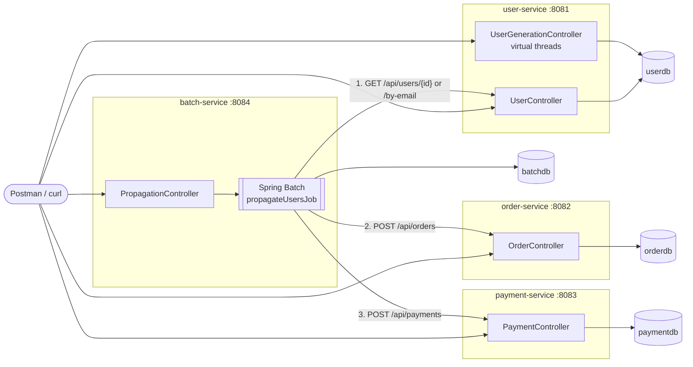

# Spring Batch Microservices

Four Spring Boot 3.5 / Java 21 microservices that simulate a real-world deployment, where every
service runs as its own process on its own port with its own PostgreSQL database:

| Service           | Port | Database    | Responsibility                                                        |
|-------------------|------|-------------|-----------------------------------------------------------------------|
| `user-service`    | 8081 | `userdb`    | User CRUD + bulk user generation using **virtual threads**            |
| `order-service`   | 8082 | `orderdb`   | Order CRUD                                                            |
| `payment-service` | 8083 | `paymentdb` | Payment CRUD                                                          |
| `batch-service`   | 8084 | `batchdb`   | **Spring Batch** job that propagates users → orders → payments over HTTP |
| `postgres`        | 5432 | –           | PostgreSQL 16, one database per service (created by `docker/postgres/init.sql`) |

## Architecture



Services never share a database. `order.userId` and `payment.orderId` / `payment.userId` are plain
ids that point at other services (no cross-database foreign keys), just like in a real microservice
system. The batch-service only talks to the others through their REST APIs.

## Tech stack

- Java 21, Spring Boot 3.5, Spring Web, Spring Data JPA, Bean Validation, Actuator
- Spring Batch 5 (job repository stored in `batchdb`)
- PostgreSQL 16
- Docker (one multi-stage `Dockerfile` for all services) + Docker Compose
- Virtual threads: `spring.threads.virtual.enabled=true` in every service (Tomcat requests run on
  virtual threads), plus explicit `Executors.newVirtualThreadPerTaskExecutor()` in the user generator
  and a virtual-thread `TaskExecutor` for launching batch jobs asynchronously

## Running with Docker (recommended)

Prerequisites: Docker with Compose v2. No local Java/Maven needed — the images are built inside Docker.

```bash
docker compose up -d --build      # build all 4 images and start everything
docker compose ps                 # check status
docker compose logs -f batch-service

# health checks
curl localhost:8081/actuator/health   # user-service
curl localhost:8082/actuator/health   # order-service
curl localhost:8083/actuator/health   # payment-service
curl localhost:8084/actuator/health   # batch-service

docker compose down               # stop (data is kept in the postgres-data volume)
docker compose down -v            # stop and DELETE all data
```

Rebuild a single service after a code change:

```bash
docker compose up -d --build order-service
```

Postgres credentials default to `postgres` / `postgres`; override them with `POSTGRES_USER`,
`POSTGRES_PASSWORD` (and the host port with `POSTGRES_PORT`) in your shell or in a `.env` file.

> `docker/postgres/init.sql` only runs when the volume is first created. If you change it, run
> `docker compose down -v` first.

## Running locally (without Docker for the apps)

Prerequisites: JDK 21 and Maven 3.9+.

```bash
docker compose up -d postgres        # just the database
mvn clean package -DskipTests        # builds all modules

java -jar user-service/target/user-service.jar &
java -jar order-service/target/order-service.jar &
java -jar payment-service/target/payment-service.jar &
java -jar batch-service/target/batch-service.jar &
```

Every setting has a `localhost` default, so no configuration is needed. Environment variables you can override:

| Variable | Used by | Default |
|---|---|---|
| `SERVER_PORT` | all | 8081 / 8082 / 8083 / 8084 |
| `DB_URL`, `DB_USERNAME`, `DB_PASSWORD` | all | `jdbc:postgresql://localhost:5432/<service db>`, `postgres`, `postgres` |
| `DB_POOL_SIZE` | user, order, payment | 30 (user), 10 (others) |
| `USER_SERVICE_URL`, `ORDER_SERVICE_URL`, `PAYMENT_SERVICE_URL` | batch | `http://localhost:8081` / `8082` / `8083` |
| `PROPAGATION_CHUNK_SIZE` | batch | 10 |

## Postman collection

Import [`postman/spring-batch-microservices.postman_collection.json`](postman/spring-batch-microservices.postman_collection.json).

- Base URLs are collection variables (`userServiceUrl`, `orderServiceUrl`, `paymentServiceUrl`, `batchServiceUrl`).
- The folders are meant to be run top to bottom (or with the Collection Runner): each *Create*
  request saves the new id (`userId`, `orderId`, `paymentId`, `propagationRequestId`) into a variable
  used by the following requests.
- Every request has a test checking the expected status code.

## API reference

All errors use the RFC 7807 `ProblemDetail` format, e.g.

```json
{ "status": 400, "title": "Bad Request", "detail": "Validation failed",
  "errors": { "email": "must be a well-formed email address" } }
```

List endpoints are paginated: `?page=0&size=20&sort=id,desc`, and return
`{ "content": [...], "page": { "size", "number", "totalElements", "totalPages" } }`.

### User service — `http://localhost:8081`

| Method | Path | Description | Success |
|---|---|---|---|
| POST | `/api/users` | Create a user | 201 |
| GET | `/api/users/{id}` | Get by id | 200 |
| GET | `/api/users/by-email?email=` | Get by email (case-insensitive) | 200 |
| GET | `/api/users` | List (paged) | 200 |
| PUT | `/api/users/{id}` | Update | 200 |
| DELETE | `/api/users/{id}` | Delete | 204 |

```json
{ "name": "Mohan Kumar", "email": "mohan@example.com", "phone": "+91 9876543210" }
```
`name` and `email` are required; `email` must be unique (409 on duplicates); `phone` is optional.

### User generator (virtual threads) — `http://localhost:8081`

| Method | Path | Description | Success |
|---|---|---|---|
| POST | `/api/users/generate` | Generate and insert N random users concurrently | 201 |

```json
{ "count": 1000, "emailPrefix": "load" }
```
Response:
```json
{ "requested": 1000, "created": 1000, "failed": 0, "durationMs": 210,
  "threadModel": "virtual-thread-per-task", "sampleErrors": [] }
```

Each user is inserted in its own virtual thread (`Executors.newVirtualThreadPerTaskExecutor()`).
`count` is 1–100,000. Emails look like `load.<random tag>.<n>@example.com`, so repeated calls never
collide. Virtual threads are cheap, so the real limit on parallel inserts is the JDBC connection pool
(`DB_POOL_SIZE`, 30 by default for user-service). Threads waiting for a connection park without
holding an OS thread.

### Order service — `http://localhost:8082`

| Method | Path | Description | Success |
|---|---|---|---|
| POST | `/api/orders` | Create an order | 201 |
| GET | `/api/orders/{id}` | Get by id | 200 |
| GET | `/api/orders?userId=` | List (paged), optional filter by user | 200 |
| PUT | `/api/orders/{id}` | Update | 200 |
| DELETE | `/api/orders/{id}` | Delete | 204 |

```json
{ "userId": 1, "productName": "Laptop", "quantity": 2, "unitPrice": 45000.50, "status": "CREATED" }
```
`totalAmount` is calculated as `quantity × unitPrice`. `status` is optional:
`CREATED` (default), `CONFIRMED`, `PAID`, `SHIPPED`, `DELIVERED`, `CANCELLED`.

### Payment service — `http://localhost:8083`

| Method | Path | Description | Success |
|---|---|---|---|
| POST | `/api/payments` | Create a payment | 201 |
| GET | `/api/payments/{id}` | Get by id | 200 |
| GET | `/api/payments?orderId=&userId=` | List (paged), optional filter by order or user | 200 |
| PUT | `/api/payments/{id}` | Update | 200 |
| DELETE | `/api/payments/{id}` | Delete | 204 |

```json
{ "orderId": 1, "userId": 1, "amount": 90001.00, "method": "UPI", "status": "PENDING" }
```
`method`: `CREDIT_CARD`, `DEBIT_CARD`, `UPI`, `NET_BANKING`, `WALLET`, `CASH_ON_DELIVERY`.
`status` is optional: `PENDING` (default), `COMPLETED`, `FAILED`, `REFUNDED`.
A unique `transactionRef` (e.g. `TXN-5C161B7C6F814086A9B5`) is generated on create.

### Propagation (Spring Batch) — `http://localhost:8084`

| Method | Path | Description | Success |
|---|---|---|---|
| POST | `/api/propagate` | Start a propagation job (async) | 202 |
| GET | `/api/propagate/{requestId}` | Status and counts (poll this) | 200 |
| GET | `/api/propagate/{requestId}/items?status=` | Result for each user, optional filter `SUCCESS`/`FAILED`/`PENDING` | 200 |
| POST | `/api/propagate/{requestId}/retry` | Run the failed items again | 202 / 409 |
| GET | `/api/propagate` | List requests, newest first | 200 |

**1. Submit** user ids and/or emails (at least one, up to 10,000; duplicates are removed):

```bash
curl -X POST localhost:8084/api/propagate -H 'Content-Type: application/json' \
     -d '{"userIds":[1,2,3],"emails":["mohan@example.com"]}'
```
```json
{ "requestId": 1, "jobExecutionId": 1, "status": "SUBMITTED", "totalItems": 4,
  "statusUrl": "http://localhost:8084/api/propagate/1",
  "itemsUrl": "http://localhost:8084/api/propagate/1/items" }
```

**2. Poll** the status until it is `COMPLETED`, `COMPLETED_WITH_ERRORS` or `FAILED`:

```json
{ "requestId": 1, "status": "COMPLETED_WITH_ERRORS", "jobExecutionId": 1,
  "jobStatus": "COMPLETED", "jobExitCode": "COMPLETED", "totalItems": 4, "attempts": 1,
  "succeeded": 3, "failed": 1, "pending": 0, ... }
```

**3. Inspect** the result for each user:

```json
{ "identifierType": "USER_ID", "identifier": "2", "status": "SUCCESS",
  "userId": 2, "userEmail": "...", "orderId": 3, "orderAmount": 499.00,
  "paymentId": 3, "paymentStatus": "COMPLETED", "transactionRef": "TXN-...",
  "failedStage": null, "errorMessage": null }
```
```json
{ "identifierType": "USER_ID", "identifier": "999999", "status": "FAILED",
  "failedStage": "USER_LOOKUP",
  "errorMessage": "user-service responded 404: {... \"detail\":\"User not found with id 999999\" ...}" }
```

## How the batch job works

```
POST /api/propagate
  │  saves a PropagationRequest + one PropagationItem per identifier  (batchdb)
  │  launches propagateUsersJob on a virtual thread, returns 202 immediately
  ▼
propagateUsersJob
 └─ propagateStep (chunk-oriented, chunk size 10)
     ├─ reader     RepositoryItemReader     → the request's PropagationItems, paged by id
     ├─ processor  CompositeItemProcessor
     │     1. UserLookupProcessor        GET  user-service    /api/users/{id} | /by-email
     │     2. OrderCreationProcessor     POST order-service   /api/orders     (sample order)
     │     3. PaymentCreationProcessor   POST payment-service /api/payments   (amount = order total)
     └─ writer     RepositoryItemWriter     → saves each item's ids / status / error to batchdb
PropagationJobListener → sets the request to RUNNING, then COMPLETED / COMPLETED_WITH_ERRORS / FAILED
```

- **The default order and payment** come from `batch-service/src/main/resources/application.yml`:

  ```yaml
  propagation:
    sample-order: { product-name: Sample Product, quantity: 1, unit-price: 499.00 }
    payment:      { method: UPI, status: COMPLETED }
  ```
- **One failing user doesn't stop the job.** If a hop fails, that item is marked `FAILED` with
  `failedStage` (`USER_LOOKUP`, `ORDER_CREATION`, `PAYMENT_CREATION`) and the error message. The job
  carries on with the other users.
- **Remote calls are retried.** Connection errors and 5xx responses are retried up to 3 times with
  backoff (`services.http.*`). 4xx responses (e.g. user not found) fail immediately.
- **Retry resumes from the hop that failed.** Every hop stores its result on the item (`userId`,
  `orderId`, `paymentId`). `POST /retry` skips `SUCCESS` items, and for a user whose order was already
  created but whose payment failed, it only creates the payment. No duplicate order is created.
- **Restarts are safe.** If batch-service stops while a job is running, Spring Batch would leave that
  execution `STARTED` forever. On startup, `OrphanedJobRecovery` marks such executions and their
  requests `FAILED`, so you can call `/retry`.
- Spring Batch metadata (`BATCH_JOB_EXECUTION`, `BATCH_STEP_EXECUTION`, …) lives in `batchdb`, next to
  the `propagation_request` / `propagation_item` tables.

## Project layout

```
.
├── pom.xml                     # parent POM (multi-module)
├── Dockerfile                  # shared multi-stage build:  --build-arg SERVICE=<module>
├── docker-compose.yml
├── docker/postgres/init.sql    # creates userdb, orderdb, paymentdb, batchdb
├── postman/                    # Postman collection
├── user-service/      controller/ service/ repository/ entity/ dto/ exception/
├── order-service/     controller/ service/ repository/ entity/ dto/ exception/
├── payment-service/   controller/ service/ repository/ entity/ dto/ exception/
└── batch-service/     controller/ service/ repository/ entity/ dto/ exception/
                       batch/   (job config, processors, listener, orphan recovery)
                       client/  (RestClient wrappers for user/order/payment services)
                       config/  (typed properties, RestClient beans)
```

## Notes and limitations

This is a demo setup. Before production you'd want to change the following:

- **Schema management:** tables are created by Hibernate `ddl-auto: update`. Use Flyway or Liquibase in production.
- **No distributed transactions:** if batch-service crashes *after* order-service has created an
  order but *before* the chunk is committed, the item doesn't know that order id. A retry then
  creates a second order. Fixing this properly needs idempotency keys on order-service and payment-service.
- **Single batch-service instance:** orphan recovery assumes one batch-service instance. With several
  instances, a node could mark another node's running job as failed.
- **No authentication or authorization** on any endpoint.
- **User deletion doesn't cascade** to orders or payments, because they live in other services.
