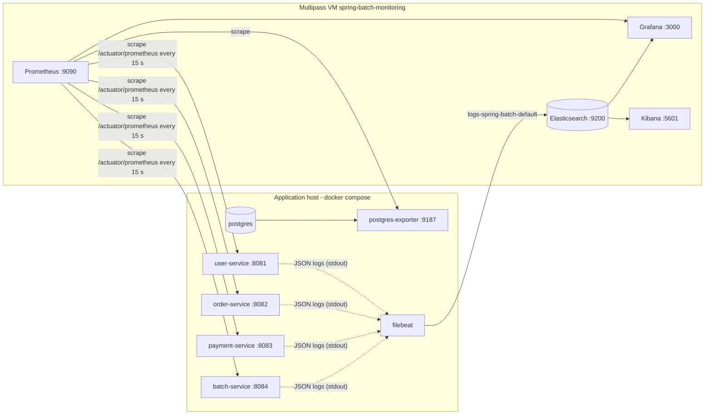

# Monitoring VM

A single [Multipass](https://multipass.run) VM runs the monitoring stack, separate from the application:

| Tool | Port | Login | What it shows |
|---|---|---|---|
| Grafana 12.1 | 3000 | `admin` / generated | Dashboard **Spring Batch microservices** (metrics + logs), alert rules |
| Kibana 9.5 | 5601 | `elastic` / generated | Discover on the **Spring Batch logs** data view |
| Prometheus 3.5 | 9090 | – | Raw metrics, targets, alerts |
| Elasticsearch 9.5 | 9200 | `elastic` / generated | Log storage (data stream `logs-spring-batch-default`) |

The VM runs only those four. The two agents that collect data run **next to the application**, in this
project's `docker-compose.yml` under the `monitoring` profile. They have to, because they read the
local Docker host:



## Quick start

Prerequisites: `multipass`, `jq`, `python3` on the application host.

```bash
monitoring/vm.sh create                     # VM + stack, first time ~5-10 min; prints URLs and passwords
docker compose --profile monitoring up -d   # app + filebeat + postgres-exporter
monitoring/vm.sh status                     # containers and Prometheus targets (all should be UP)
```

Then open Grafana at the printed URL. The **Spring Batch microservices** dashboard is the home page.
Generate some traffic to see it move:

```bash
curl -X POST localhost:8081/api/users/generate -H 'Content-Type: application/json' -d '{"count":100000}'
curl -X POST localhost:8084/api/propagate/bulk -H 'Content-Type: application/json' -d '{"count":20000}'
```

## Commands

| Command | What it does |
|---|---|
| `monitoring/vm.sh create` | Launches the VM (Ubuntu 24.04, 4 CPUs, 6 GB RAM, 30 GB disk; installs Docker with cloud-init), then `deploy` |
| `monitoring/vm.sh deploy` | Pushes `monitoring/vm/` to the VM and applies it (see below). Run it after **any** change in `monitoring/vm/` |
| `monitoring/vm.sh status` | VM state, container health, Prometheus targets with their last error |
| `monitoring/vm.sh urls` | URLs and logins |
| `monitoring/vm.sh start` / `stop` | Start or stop the VM. Data is kept, and containers restart automatically |
| `monitoring/vm.sh shell` | Shell on the VM (the stack is in `~/monitoring`) |
| `monitoring/vm.sh destroy` | Deletes the VM and all its data (asks first) |

Sizing can be changed with environment variables, e.g. `VM_MEMORY=8G ES_HEAP=2g monitoring/vm.sh create`.
Other settings: `VM_NAME`, `VM_CPUS`, `VM_DISK`, `VM_IMAGE`, `LOG_RETENTION_DAYS` (default 7).

### What `deploy` does

1. Generates passwords on first run (`monitoring/.generated/secrets.env`, git-ignored, mode 600).
2. Regenerates the Grafana dashboard from `grafana/generate_dashboards.py`.
3. Writes the Prometheus config. The app's address, as seen from the VM (the multipass network
   gateway), replaces `__APP_HOST__` in `prometheus.yml.tmpl`.
4. Copies any image the VM lacks but this machine already has into the VM (`docker save` + `multipass
   transfer`), which beats pulling. docker.elastic.co managed only ~370 KB/s here, so the Elasticsearch
   and Kibana images took 1 minute instead of 40.
5. Syncs everything into `~/monitoring` on the VM (`rsync --delete`, in place, because running
   containers bind-mount those folders) and runs `docker compose up -d`, which recreates only containers
   whose settings changed.
6. Runs `elastic/setup.sh`: users, roles, log retention and the Kibana data view (safe to run again).
7. Reloads Prometheus (`POST /-/reload`, no restart) and restarts Grafana (for data source changes).
8. Writes `monitoring/.generated/app.env` (Elasticsearch URL and Filebeat password) for Filebeat, and
   recreates Filebeat if it's running.

## Making changes

**Change something in this project, run `monitoring/vm.sh deploy`, and it shows up on the VM:**

| You change | Where | Then |
|---|---|---|
| Dashboard panels | `monitoring/vm/grafana/generate_dashboards.py` | `vm.sh deploy` |
| Scrape targets / interval | `monitoring/vm/prometheus/prometheus.yml.tmpl` | `vm.sh deploy` |
| Alert rules | `monitoring/vm/prometheus/rules/*.yml` | `vm.sh deploy` |
| Grafana data sources | `monitoring/vm/grafana/provisioning/` | `vm.sh deploy` |
| ES users / retention / Kibana data view | `monitoring/vm/elastic/setup.sh` | `vm.sh deploy` |
| Image versions, ports, heap | `monitoring/vm/docker-compose.yml` | `vm.sh deploy` |
| A new metric in a service | Java code (`MeterRegistry`) | rebuild the service; Prometheus picks it up on the next scrape. Add a panel and `vm.sh deploy` |
| A new service | `docker-compose.yml` + `prometheus.yml.tmpl` (target) + `filebeat.yml` (log condition) | `docker compose ... up -d`, `vm.sh deploy` |
| What logs are shipped | `monitoring/app/filebeat.yml` | `docker compose --profile monitoring up -d --force-recreate filebeat` |

Grafana dashboards are provisioned read-only: edits made in the UI aren't saved. Change the generator
instead, so dashboards stay in git.

## What the application exposes

**Metrics:** every service has `GET /actuator/prometheus` (Micrometer). Each metric carries an
`application` label.

| Metric | From | Meaning |
|---|---|---|
| `http_server_requests_seconds_*` | all | Incoming requests by `uri`, `method`, `status`; histogram for p95/p99 |
| `http_client_requests_seconds_*` | batch | Calls to user/order/payment-service (`client_name`) |
| `jvm_*`, `process_cpu_usage`, `hikaricp_connections_*` | all | JVM, CPU, DB connection pool |
| `users_added_total{source="api\|generator"}` | user | Users created via the API or the virtual-thread generator |
| `users_generation_seconds_*`, `users_generation_failed_total` | user | Generator runs and failed rows |
| `orders_placed_total{status}`, `orders_amount_*` | order | Orders and their amounts |
| `payments_processed_total{method,status}`, `payments_amount_*` | payment | Payments and their amounts |
| `propagation_users_total{result,stage}` | batch | Users propagated (`success`), or failed with the hop that failed |
| `propagation_requests_total{type}`, `propagation_bulk_selected_users_total` | batch | Requests (MANUAL/BULK) and users claimed by bulk selection |
| `spring_batch_job_*`, `spring_batch_step_*`, `spring_batch_item_process_*`, `spring_batch_chunk_write_*` | batch | Spring Batch's built-in metrics |
| `pg_*` | postgres-exporter | Database sizes, connections, commits, rows inserted/updated |

> The Prometheus client drops a trailing `_created` from counter names, because the OpenMetrics format
> reserves it. That's why the counters are called `users.added` / `orders.placed` /
> `payments.processed` rather than `*.created`.

**Logs:** in Docker the services log **ECS JSON**, one object per line
(`LOGGING_STRUCTURED_FORMAT_CONSOLE=ecs`, Spring Boot's built-in structured logging). Filebeat stores
those objects as they are. The useful fields are `service.name`, `log.level`, `log.logger`,
`process.thread.name`, `message` and `error.*`. Postgres and the exporter log plain text, which is
stored as `message`. `docker compose logs` therefore shows JSON. Run a jar directly to get plain-text
logs.

**Alerts** (`prometheus/rules/spring-batch.yml`): `ServiceDown`, `HighHttpErrorRate` (> 5% 5xx),
`SlowHttpRequests` (p95 > 1 s), `PropagationFailures`, `DbConnectionPoolExhausted`, `JvmHeapHigh`.
They are visible in Prometheus → Alerts and Grafana → Alerting. No notifications are configured.

## Security notes

- Elasticsearch runs as a single node with **0 replicas** (set in `elastic/setup.sh`), so cluster health is GREEN.
- Elasticsearch security is **on**. Each client gets its own user with only what it needs:
  `spring-batch-filebeat` can only write `logs-spring-batch-*`, and `spring-batch-grafana` can only
  read them. People sign in to Kibana as `elastic`. Kibana talks to Elasticsearch as `kibana_system`.
- Passwords are random, generated once into `monitoring/.generated/secrets.env` (git-ignored), and
  copied to the VM as `~/monitoring/.env` (mode 600).
- Plain HTTP, no TLS: the multipass network is only reachable from this machine. Don't publish these
  ports elsewhere without adding TLS.
- Prometheus has no login. The application's `/actuator/prometheus` endpoints and postgres-exporter
  (`:9187`) are published on all interfaces of the application host, like the API ports already were.

## Troubleshooting

| Symptom | Check |
|---|---|
| Targets DOWN in `vm.sh status` | Is the app running with `--profile monitoring`? From the VM: `multipass exec spring-batch-monitoring -- curl -s <app-host>:8081/actuator/health` |
| No logs in Kibana/Grafana | `docker compose logs filebeat`; does `monitoring/.generated/app.env` exist? (`vm.sh deploy` writes it) Then `docker compose --profile monitoring up -d --force-recreate filebeat` |
| Elasticsearch won't start | `vm.sh shell`, then `docker compose -f ~/monitoring/docker-compose.yml logs elasticsearch`. Often memory: raise `VM_MEMORY` / lower `ES_HEAP` |
| `create` stuck on "Pulling" for a long time | A slow registry. Stop it (Ctrl+C), `docker pull` the image on this machine, then `vm.sh deploy`: it copies local images into the VM |
| VM IP changed after a reboot | `vm.sh deploy` (updates Grafana/Kibana URLs and Filebeat's Elasticsearch address) |
